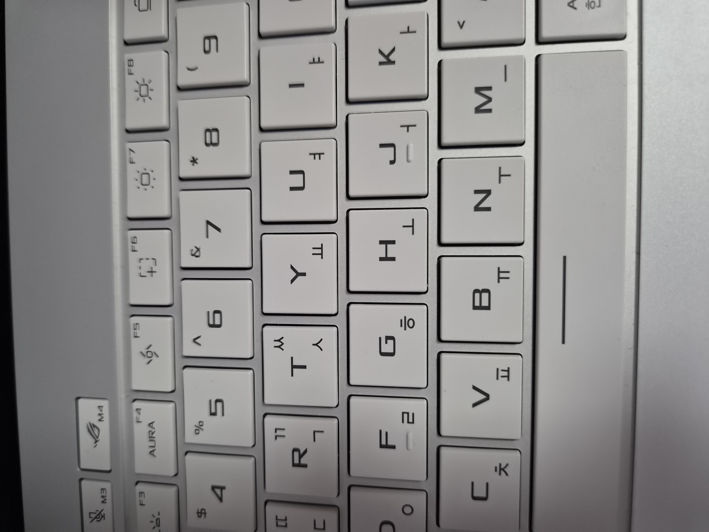
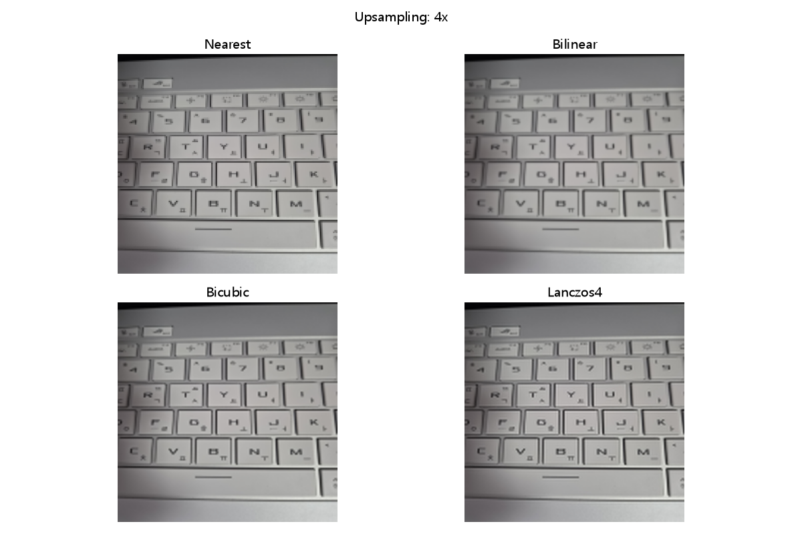
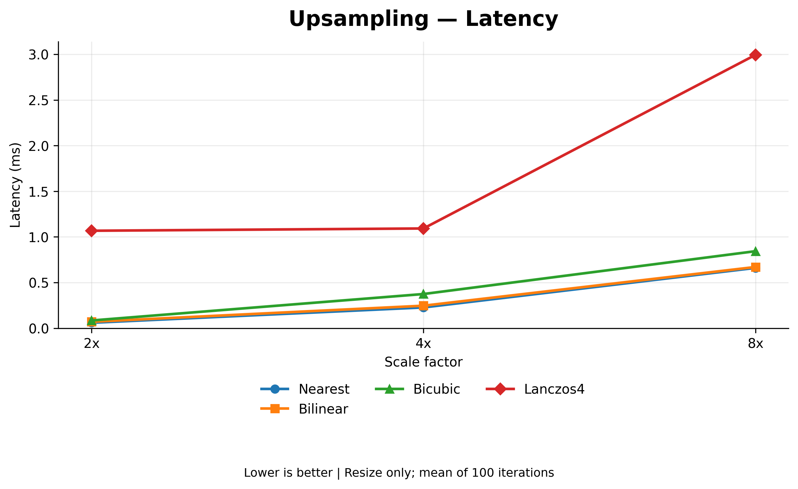
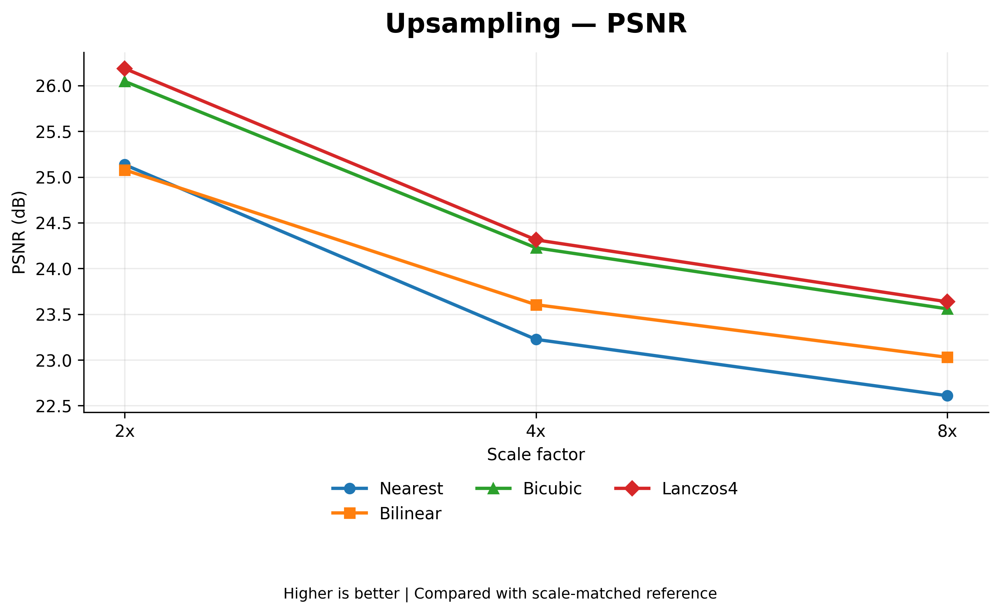
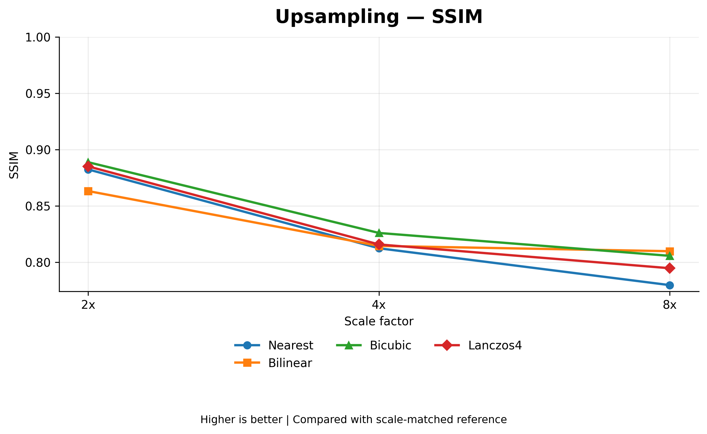
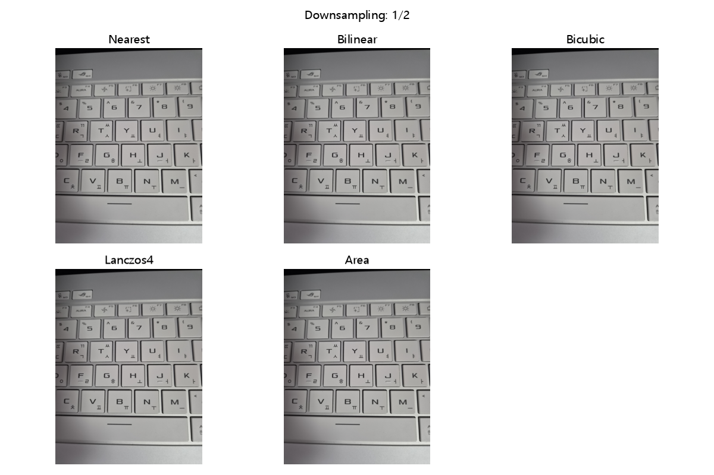
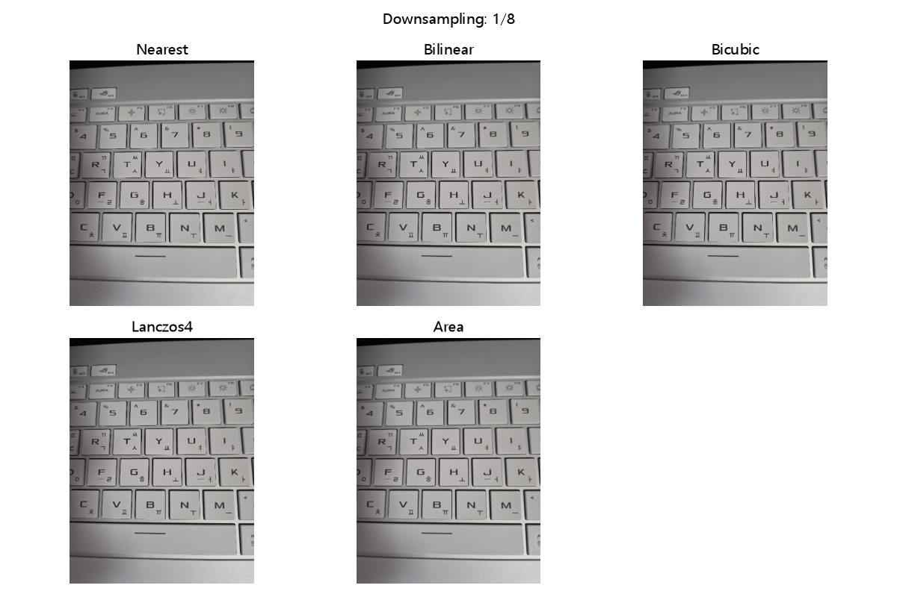
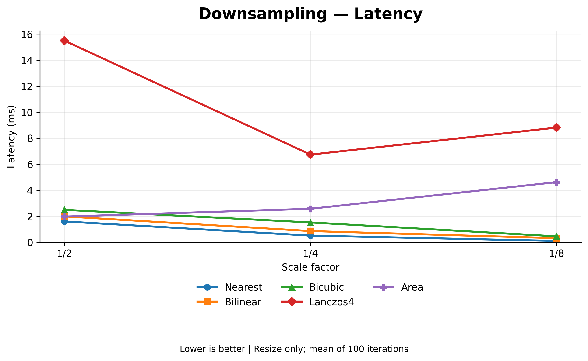
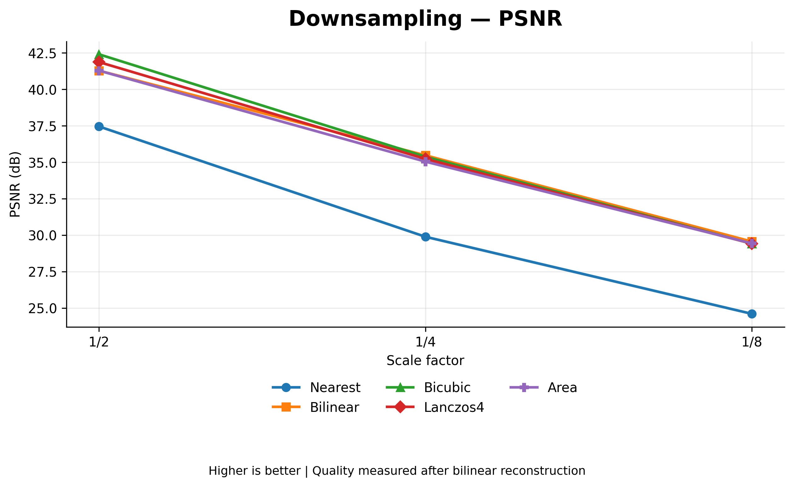
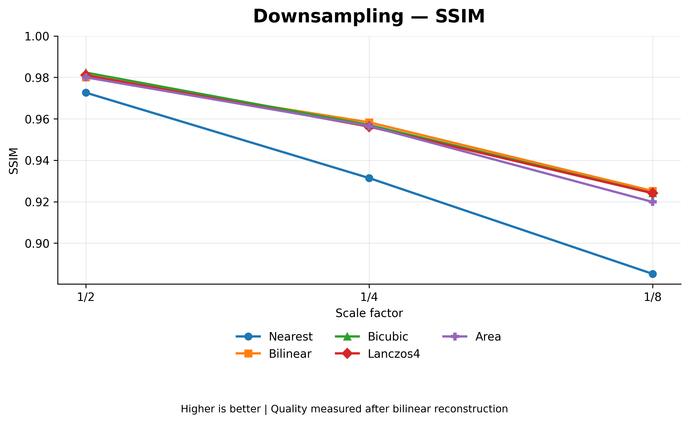

# Image Interpolation Performance Benchmark

## 1. Overview

OpenCV 기반 이미지 확대 및 축소 과정에서 보간법에 따른 처리 속도와 이미지 품질을 정량적으로 비교하는 프로젝트이다.

로봇 비전 및 객체 검출 시스템에서 이미지 크기 변환은 주요 전처리 과정 중 하나이다.

본 프로젝트에서는 다양한 보간법의 Latency, PSNR, SSIM을 측정하여 처리 속도와 이미지 품질 사이의 Trade-off를 분석하였다.

### Original Image



## 2. Interpolation Methods

| Method | OpenCV Function | Description |
|---|---|---|
| Nearest Neighbor | INTER_NEAREST | 가장 가까운 픽셀값 사용 |
| Bilinear | INTER_LINEAR | 주변 4개 픽셀 기반 보간 |
| Bicubic | INTER_CUBIC | 주변 16개 픽셀 기반 보간 |
| Lanczos4 | INTER_LANCZOS4 | 주변 8×8 픽셀 기반 보간 |
| Area | INTER_AREA | 원본 픽셀 영역의 기여도를 기반으로 크기 변환 |

## 3. Evaluation Metrics

| Metric | Description | Direction |
|---|---|---|
| Latency (ms) | 평균 이미지 크기 변환 시간 | Lower is better |
| PSNR (dB) | 기준 이미지와의 픽셀값 오차 기반 품질 지표 | Higher is better |
| SSIM | 밝기, 대비, 구조 기반 유사도 | Higher is better |

## 4. Experimental Setup

- Language: Python
- Libraries: OpenCV, Matplotlib, scikit-image
- Warm-up: 10 iterations
- Benchmark: 100 iterations
- Timer: time.perf_counter()
- Input Image: keyboard.jpg
- Number of Test Images: 1
- Execution: CPU-based image resizing

Warm-up과 Benchmark는 동일한 입력 및 출력 해상도에서 수행하였다.

Latency는 cv2.resize()의 100회 반복 실행 시간을 기준으로 평균값을 계산하였다.

PSNR, SSIM 계산 및 이미지 시각화 시간은 Latency 측정에서 제외하였다.

## 5. Upsampling Experiment

### Methodology

원본 이미지를 Area 보간법으로 150×150 해상도까지 축소한 후, 4가지 보간법을 이용하여 각각 2배, 4배, 8배 확대하였다.

기준 이미지는 원본 이미지를 INTER_AREA를 사용하여 각 출력 해상도에 맞게 변환한 이미지이다.

동일한 저해상도 입력을 사용하여 확대 보간법에 따른 처리 속도 및 이미지 품질을 비교하였다.

### Experimental Pipeline

```text
Original Image
    ↓
Area Downsampling (150×150)
    ↓
Upsampling
    ├── Nearest
    ├── Bilinear
    ├── Bicubic
    └── Lanczos4
    ↓
PSNR and SSIM Evaluation
```

| Scale | Input Resolution | Output Resolution |
|---|---|---|
| 2x | 150×150 | 300×300 |
| 4x | 150×150 | 600×600 |
| 8x | 150×150 | 1200×1200 |

### Experimental Results

| Scale | Method | Latency (ms) ↓ | PSNR (dB) ↑ | SSIM ↑ |
|---|---|---:|---:|---:|
| 2x | Nearest | **0.059** | 25.135 | 0.8823 |
| 2x | Bilinear | 0.070 | 25.078 | 0.8631 |
| 2x | Bicubic | 0.084 | 26.046 | **0.8887** |
| 2x | Lanczos4 | 1.067 | **26.187** | 0.8850 |
| 4x | Nearest | **0.227** | 23.225 | 0.8123 |
| 4x | Bilinear | 0.246 | 23.604 | 0.8144 |
| 4x | Bicubic | 0.374 | 24.226 | **0.8259** |
| 4x | Lanczos4 | 1.092 | **24.313** | 0.8157 |
| 8x | Nearest | **0.660** | 22.609 | 0.7796 |
| 8x | Bilinear | 0.670 | 23.029 | **0.8097** |
| 8x | Bicubic | 0.843 | 23.559 | 0.8056 |
| 8x | Lanczos4 | 2.993 | **23.636** | 0.7946 |

굵게 표시된 값은 동일한 확대 배율에서 가장 우수한 측정값이다.

### Visual Results

#### 2x Upsampling


#### 4x Upsampling



#### 8x Upsampling


### Performance Graphs

#### Latency



#### PSNR



#### SSIM



### Analysis

- Nearest는 모든 확대 배율에서 가장 낮은 Latency를 기록하였다.
- Lanczos4는 모든 확대 배율에서 가장 높은 PSNR을 기록하였으나 상대적으로 높은 처리 시간이 발생하였다.
- Bicubic은 2배 및 4배 확대에서 가장 높은 SSIM을 기록하였다.
- Bilinear는 8배 확대에서 가장 높은 SSIM을 기록하였다.
- 확대 배율이 증가함에 따라 모든 보간법에서 PSNR과 SSIM이 감소하는 경향이 관찰되었다. 다만 확대 배율별 기준 이미지의 해상도가 서로 다르다는 점을 고려해야 한다.

### Speed-Quality Trade-off

4배 확대에서 Bicubic과 Lanczos4의 성능을 비교하였다.

| Metric | Bicubic | Lanczos4 |
|---|---:|---:|
| Latency (ms) | **0.374** | 1.092 |
| PSNR (dB) | 24.226 | **24.313** |
| SSIM | **0.8259** | 0.8157 |

Lanczos4의 PSNR은 Bicubic보다 0.087 dB 높았으나 처리 시간은 약 2.92배 길었다.

반면 Bicubic은 Lanczos4보다 높은 SSIM을 기록하였다.

따라서 본 실험에서 Bicubic은 이미지 품질과 처리 속도 사이에서 균형 잡힌 성능을 나타냈다.

## 6. Downsampling and Reconstruction Experiment

### Methodology

원본 이미지에 5가지 보간법을 적용하여 가로 및 세로 해상도를 각각 1/2, 1/4, 1/8로 축소하였다.

축소 과정의 처리 시간을 측정한 후, PSNR 및 SSIM 계산을 위해 모든 축소 이미지를 Bilinear 보간법으로 원본 크기까지 복원하였다.

복원 보간법을 고정함으로써 동일한 복원 조건에서 축소 보간법에 따른 정보 보존 성능을 비교하였다.

Latency 측정에는 복원 과정의 처리 시간이 포함되지 않는다.

### Experimental Pipeline

```text
Original Image
    ↓
Downsampling
    ├── Nearest
    ├── Bilinear
    ├── Bicubic
    ├── Lanczos4
    └── Area
    ↓
Bilinear Reconstruction
    ↓
PSNR and SSIM Evaluation
    ↓
Comparison with Original Image
```

| Scale | Remaining Pixel Ratio |
|---|---:|
| 1/2 | Approximately 25% |
| 1/4 | Approximately 6.25% |
| 1/8 | Approximately 1.56% |

### Experimental Results

| Scale | Method | Latency (ms) ↓ | PSNR (dB) ↑ | SSIM ↑ |
|---|---|---:|---:|---:|
| 1/2 | Nearest | **1.600** | 37.454 | 0.9726 |
| 1/2 | Bilinear | 1.988 | 41.284 | 0.9800 |
| 1/2 | Bicubic | 2.493 | **42.404** | **0.9823** |
| 1/2 | Lanczos4 | 15.498 | 41.872 | 0.9811 |
| 1/2 | Area | 1.974 | 41.284 | 0.9800 |
| 1/4 | Nearest | **0.511** | 29.887 | 0.9314 |
| 1/4 | Bilinear | 0.861 | **35.473** | **0.9583** |
| 1/4 | Bicubic | 1.523 | 35.377 | 0.9570 |
| 1/4 | Lanczos4 | 6.738 | 35.229 | 0.9562 |
| 1/4 | Area | 2.574 | 35.042 | 0.9565 |
| 1/8 | Nearest | **0.103** | 24.600 | 0.8852 |
| 1/8 | Bilinear | 0.316 | **29.556** | **0.9252** |
| 1/8 | Bicubic | 0.455 | 29.415 | 0.9242 |
| 1/8 | Lanczos4 | 8.817 | 29.415 | 0.9241 |
| 1/8 | Area | 4.622 | 29.433 | 0.9199 |

굵게 표시된 값은 동일한 축소 배율에서 가장 우수한 측정값이다.

### Visual Results

다음 이미지는 각 보간법을 적용한 축소 결과이며, PSNR과 SSIM은 별도로 생성한 복원 이미지를 기준으로 계산하였다.

#### 1/2 Downsampling



#### 1/4 Downsampling


#### 1/8 Downsampling



### Performance Graphs

#### Latency



#### PSNR



#### SSIM



### Analysis

- Nearest는 모든 축소 비율에서 가장 낮은 Latency를 기록하였으나 복원 이미지의 PSNR과 SSIM 또한 가장 낮았다.
- Bicubic은 1/2 축소에서 가장 높은 PSNR과 SSIM을 기록하였다.
- Bilinear는 1/4 및 1/8 축소에서 가장 높은 PSNR과 SSIM을 기록하였다.
- 1/2 축소에서는 Bilinear와 Area의 PSNR 및 SSIM이 동일하게 측정되었다.
- Area는 축소 정도가 증가함에 따라 처리 시간이 증가하는 경향을 보였다.
- Lanczos4는 높은 처리 비용에도 불구하고 본 축소 및 복원 실험에서는 가장 높은 품질 지표를 달성하지 못하였다.

### Speed-Quality Trade-off

1/8 축소에서 Bilinear와 Area의 성능을 비교하였다.

| Metric | Bilinear | Area |
|---|---:|---:|
| Latency (ms) | **0.316** | 4.622 |
| PSNR (dB) | **29.556** | 29.433 |
| SSIM | **0.9252** | 0.9199 |

Bilinear는 Area보다 약 14.63배 빠른 축소 처리 속도를 기록하였으며, 동일한 복원 조건에서 더 높은 PSNR과 SSIM을 나타냈다.

일반적으로 Area는 이미지 축소 시 앨리어싱을 억제하는 데 유리한 보간법으로 사용된다.

그러나 본 실험에서는 Bilinear가 처리 속도와 복원 품질 측면에서 우수한 결과를 나타냈다.

이는 보간법의 성능이 입력 이미지, 축소 배율 및 평가 방법에 따라 달라질 수 있음을 보여준다.

단, 본 실험 결과가 Bilinear의 앨리어싱 억제 성능이 Area보다 우수하다는 것을 의미하지는 않는다.

## 7. Overall Performance Comparison

| Evaluation | Upsampling | Downsampling |
|---|---|---|
| Lowest Latency | Nearest | Nearest |
| Highest PSNR | Lanczos4 | Bicubic / Bilinear |
| Highest SSIM | Bicubic / Bilinear | Bicubic / Bilinear |
| Speed-Quality Trade-off | Bicubic / Bilinear | Bilinear |

본 실험에서 측정한 주요 특징은 다음과 같다.

| Method | Characteristics |
|---|---|
| Nearest | 낮은 처리 비용, 상대적으로 낮은 품질 지표 |
| Bilinear | 빠른 처리 속도와 양호한 품질 |
| Bicubic | 확대 실험에서 우수한 속도 및 품질 균형 |
| Lanczos4 | 확대 실험에서 높은 PSNR, 높은 처리 비용 |
| Area | 축소 및 앨리어싱 억제에 적합한 후보 |

## 8. Application to Robot Vision

실시간 로봇 비전 시스템에서는 이미지 품질뿐만 아니라 전처리 과정의 처리 시간도 중요한 요소이다.

카메라로부터 입력된 고해상도 이미지는 객체 검출 모델의 입력 해상도에 맞게 변환될 수 있다.

```text
Camera
    ↓
Image Acquisition
    ↓
Image Resizing and Preprocessing
    ↓
Object Detection (YOLO)
    ↓
Position Estimation
    ↓
Robot Control
```

본 실험 결과를 기반으로 다음과 같은 활용 가능성을 고려할 수 있다.

| Method | Potential Application |
|---|---|
| Nearest | 연산 비용 최소화가 필요한 환경 |
| Bilinear | 실시간 객체 검출을 위한 이미지 크기 변환 |
| Bicubic | 이미지 품질을 고려한 확대 및 전처리 |
| Lanczos4 | 처리 시간보다 픽셀값 복원 품질이 중요한 환경 |
| Area | 앨리어싱 억제가 중요한 이미지 축소 |

특히 Bilinear는 본 축소 실험에서 낮은 처리 시간과 높은 복원 품질을 기록하였으므로 실시간 로봇 비전 시스템의 전처리 보간법 후보로 고려할 수 있다.

실제 객체 검출 정확도 및 전체 시스템 처리 시간에 미치는 영향은 별도의 모델 기반 실험을 통해 검증해야 한다.

## 9. Limitations

- 단일 이미지에 대한 실험이므로 모든 이미지에 결과를 일반화하기 어렵다.
- 확대 배율별 기준 이미지의 해상도가 서로 다르다.
- 확대 실험에서 원본 이미지의 가로세로 비율이 유지되지 않을 수 있다.
- 축소 실험의 PSNR과 SSIM에는 Bilinear 복원 과정의 영향이 포함된다.
- 확대 실험과 축소 실험의 평가 방식이 다르므로 절대적인 품질 수치를 직접 비교하기 어렵다.
- Latency의 표준편차 및 반복 실험 간 변동성은 분석하지 않았다.
- 앨리어싱 억제 성능은 별도로 정량화하지 않았다.
- 실제 객체 검출 모델의 mAP 및 전체 시스템 Latency는 평가하지 않았다.

## 10. Conclusion

본 프로젝트에서는 OpenCV 기반 이미지 확대 및 축소 과정에서 보간법별 처리 속도와 이미지 품질을 정량적으로 비교하였다.

확대 실험에서 Nearest는 모든 배율에서 가장 빠른 처리 속도를 기록하였으며, Lanczos4는 가장 높은 PSNR을 나타냈다.

Bicubic은 Lanczos4와 유사한 PSNR을 유지하면서 더 낮은 처리 시간을 기록하여 속도와 이미지 품질 측면에서 균형 잡힌 성능을 나타냈다.

축소 및 복원 실험에서는 Bilinear가 1/4 및 1/8 축소에서 가장 높은 PSNR과 SSIM을 기록하면서 비교적 낮은 처리 시간을 나타냈다.

이를 통해 이미지 전처리 과정에서 보간법을 선택할 때 이미지 품질과 연산 비용을 함께 고려해야 함을 확인하였다.

향후 실제 객체 검출 모델을 활용하여 보간법에 따른 검출 정확도 및 처리 속도의 변화를 분석할 예정이다.

## 11. Project Structure

```text
Interpolation/
├── images/
│   └── keyboard.jpg
├── results/
│   ├── Downsampling_1-2.png
│   ├── Downsampling_1-4.png
│   ├── Downsampling_1-8.png
│   ├── Downsampling_Latency.png
│   ├── Downsampling_PSNR.png
│   ├── Downsampling_SSIM.png
│   ├── Upsampling_2x.png
│   ├── Upsampling_4x.png
│   ├── Upsampling_8x.png
│   ├── Upsampling_Latency.png
│   ├── Upsampling_PSNR.png
│   └── Upsampling_SSIM.png
├── downsampling_comparison.py
├── upsampling_comparison.py
└── README.md
```

## 12. Installation and Usage

### Install Dependencies

```bash
pip install opencv-python matplotlib scikit-image
```

### Run Upsampling Experiment

```bash
python upsampling_comparison.py
```

### Run Downsampling Experiment

```bash
python downsampling_comparison.py
```

이미지 경로는 pathlib을 사용하여 프로젝트 폴더를 기준으로 설정하였다.

기존 측정 결과는 results 폴더에서 확인할 수 있다.

실험을 다시 실행할 경우 실행 환경에 따라 Latency 측정값이 달라질 수 있다.

## 13. Future Work

- 다양한 이미지 데이터셋을 활용한 성능 검증
- 반복 실험을 통한 Latency 평균 및 표준편차 분석
- 복원 과정 없이 축소 이미지 품질을 직접 평가하는 실험
- 보간법별 앨리어싱 억제 성능 분석
- YOLO 객체 검출 모델의 mAP 및 Inference Latency 비교
- 실시간 로봇 비전 시스템 적용 및 검증
````