# Automatic Document Scanner with OpenCV

> Performance Optimization of Document Detection and Perspective Correction

OpenCV 기반 자동 문서 스캔 및 원근 보정 알고리즘 개발·성능 최적화 프로젝트

---

## 1. Project Overview (프로젝트 개요)

본 프로젝트는 Python과 OpenCV를 활용하여 이미지에서 문서 영역을 자동으로 검출하고, Perspective Transformation을 통해 정면에서 촬영한 형태의 이미지로 변환하는 것을 목표로 한다.

초기에는 사용자가 직접 꼭짓점을 선택하는 수동 원근 변환 방식을 구현하였다. 이후 영상 전처리, 경계선 검출, 윤곽선 검출 및 다각형 근사를 적용하여 자동 문서 스캔 알고리즘을 개발하였다.

초기 알고리즘에서 발생한 오검출 및 미검출 문제를 분석하고, V1부터 V3까지 단계적으로 개선하여 문서 검출 성능과 처리 속도를 향상시켰다.

### Key Results

| Metric | V1 | V2 | V3 |
|---|---:|---:|---:|
| Detection Success Rate | 33.3% | 50.0% | 100% |
| Successfully Detected Images | 2/6 | 3/6 | 6/6 |
| Average Detection Latency | 24.608 ms | 24.256 ms | 6.145 ms |
| Detection Speedup | 1.00x | 1.01x | 4.00x |
| Latency Reduction | - | 1.43% | 75.03% |

검출 성공률은 프로젝트에서 사용한 6장의 테스트 이미지에 대한 육안 평가 결과이다.

---

## 2. Development Environment (개발 환경)

- Python
- OpenCV
- NumPy
- Matplotlib
- Visual Studio Code
- Git / GitHub
- Fork

---

## 3. Project Objectives (프로젝트 목표)

- Perspective Transformation의 원리 이해
- 수동 및 자동 원근 변환 구현
- 영상 전처리를 통한 노이즈 감소
- 문서 외곽선 및 꼭짓점 자동 검출
- 오검출 및 미검출 원인 분석
- 영상 처리 파라미터 최적화
- 입력 해상도 최적화를 통한 연산량 감소
- 알고리즘 버전별 정량적 성능 비교

---

## 4. Manual Perspective Transformation

자동 문서 검출 알고리즘을 개발하기 전에 마우스를 사용하여 문서의 꼭짓점 4개를 직접 선택하는 수동 원근 변환 방식을 구현하였다.

### Processing Steps

1. 원본 이미지 입력
2. 미리보기 이미지 크기 조절
3. 마우스를 이용한 꼭짓점 4개 선택
4. 원본 이미지 좌표로 복원
5. Perspective Transformation Matrix 계산
6. 원근 변환 수행
7. 결과 이미지 저장

### OpenCV Functions

- cv2.setMouseCallback()
- cv2.getPerspectiveTransform()
- cv2.warpPerspective()

### Limitations

사용자가 직접 꼭짓점을 선택해야 하며, 선택 위치와 순서에 따라 결과가 달라질 수 있다.

이러한 한계를 해결하기 위해 자동 문서 검출 알고리즘을 개발하였다.

---

## 5. Automatic Document Scanner Pipeline

최종 V3 알고리즘은 다음과 같은 영상 처리 구조로 구성된다.

```text
Original Image
       |
       v
Resolution Normalization
       |
       v
Grayscale Conversion
       |
       v
Gaussian Blur
       |
       v
Canny Edge Detection
       |
       v
Morphological Closing
       |
       v
Contour Detection
       |
       v
Contour Area Filtering
       |
       v
Convex Hull
       |
       v
Polygon Approximation
       |
       v
Corner Point Ordering
       |
       v
Original Coordinate Recovery
       |
       v
Perspective Transformation
       |
       v
Scanned Document
```

---

## 6. Image Processing Methods (영상 처리 기법)

### 6.1 Original Image

문서의 외곽선 및 내부 표가 포함된 이미지를 사용하여 영상 처리 과정을 확인하였다.

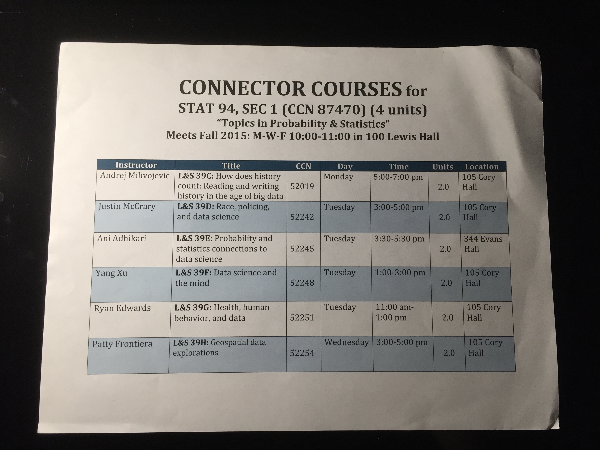

### 6.2 Grayscale Conversion

컬러 이미지를 단일 채널의 흑백 이미지로 변환하였다.

이를 통해 이후 경계선 검출에 필요한 영상 처리 구조를 단순화하였다.

- Function: cv2.cvtColor()
- Conversion: BGR to Grayscale

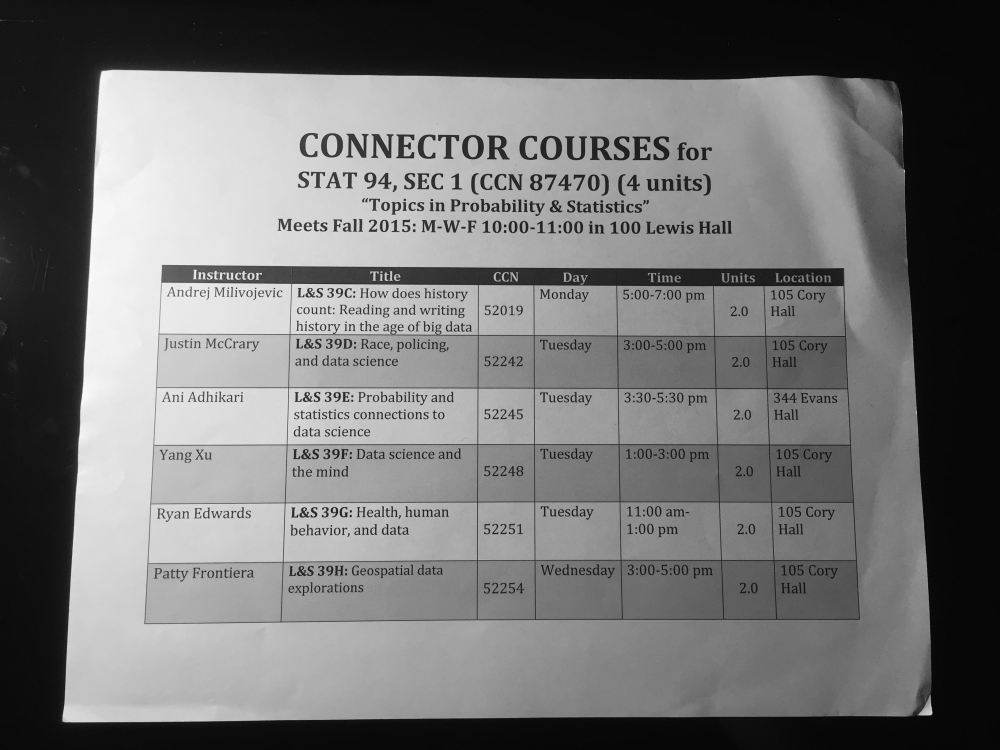

### 6.3 Gaussian Blur

책상 표면의 질감, 문서 내부의 세부 경계선 및 불필요한 영상 노이즈를 감소시키기 위해 Gaussian Blur를 적용하였다.

다양한 커널 크기를 실험하였으며, 최종 알고리즘에서는 9x9 커널을 사용하였다.

- Function: cv2.GaussianBlur()
- Kernel Size: 9x9


### 6.4 Canny Edge Detection

영상의 밝기 변화가 큰 영역을 검출하여 문서의 경계선을 추출하였다.

Canny Threshold를 변경하면서 문서 외곽선 검출 성능과 배경 노이즈의 영향을 비교하였다.

최종 알고리즘에서는 다음과 같은 임계값을 사용하였다.

- Function: cv2.Canny()
- Low Threshold: 30
- High Threshold: 100

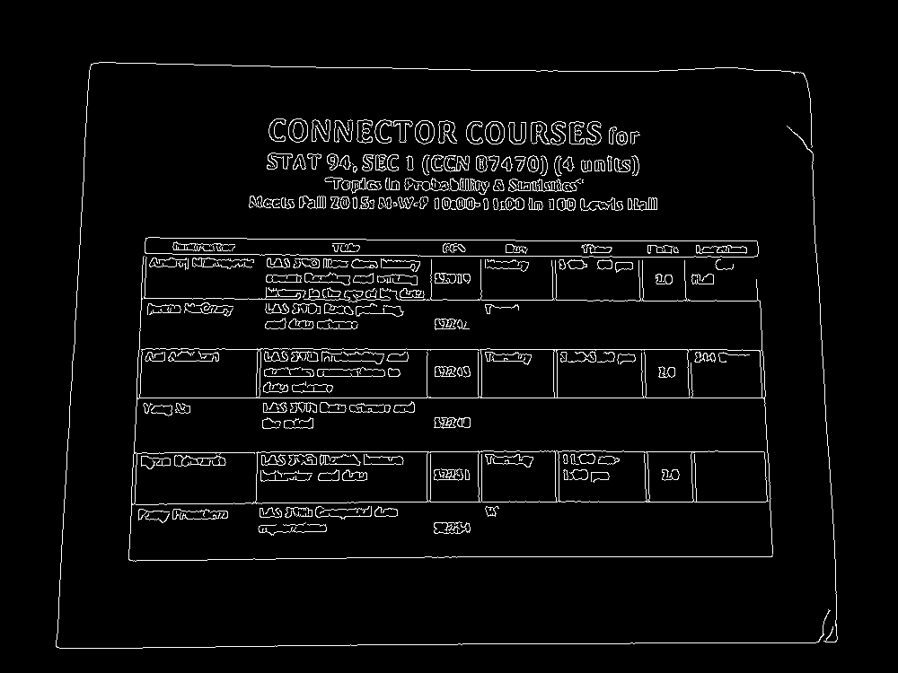

### 6.5 Morphological Closing

Canny Edge Detection 이후 발생하는 경계선의 작은 단절을 연결하기 위해 Morphological Closing을 적용하였다.

Closing은 Dilation 이후 Erosion을 수행하는 형태학적 영상 처리 연산이다.

- Function: cv2.morphologyEx()
- Operation: MORPH_CLOSE
- Kernel Size: 7x7

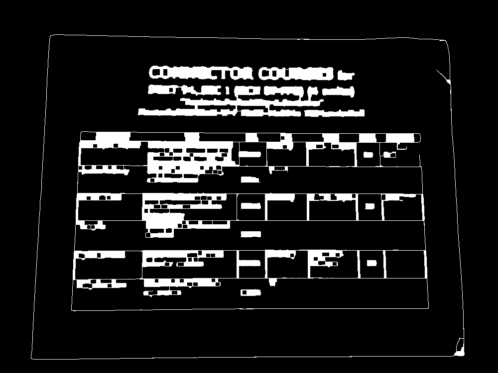

### 6.6 Contour Detection

경계선 이미지에서 연결된 윤곽선을 검출하였다.

검출된 윤곽선을 면적 기준으로 내림차순 정렬하여 문서 후보를 탐색하였다.

- Function: cv2.findContours()
- Retrieval Mode: RETR_EXTERNAL
- Approximation Method: CHAIN_APPROX_SIMPLE

### 6.7 Contour Area Filtering

문서 내부의 표와 작은 사각형이 문서 영역으로 잘못 검출되는 문제를 감소시키기 위해 최소 윤곽선 면적 조건을 추가하였다.

최소 면적은 전체 처리 이미지 면적의 5%로 설정하였다.

```python
image_area = resized.shape[0] * resized.shape[1]
min_area = image_area * 0.05
```

### 6.8 Convex Hull

복잡하거나 오목한 윤곽선으로 인해 다각형 근사에 실패하는 문제를 개선하기 위해 Convex Hull을 적용하였다.

Convex Hull은 윤곽선을 포함하는 볼록 껍질을 생성한다.

이를 통해 윤곽선의 오목한 부분이 사각형 검출에 미치는 영향을 감소시켰다.

- Function: cv2.convexHull()

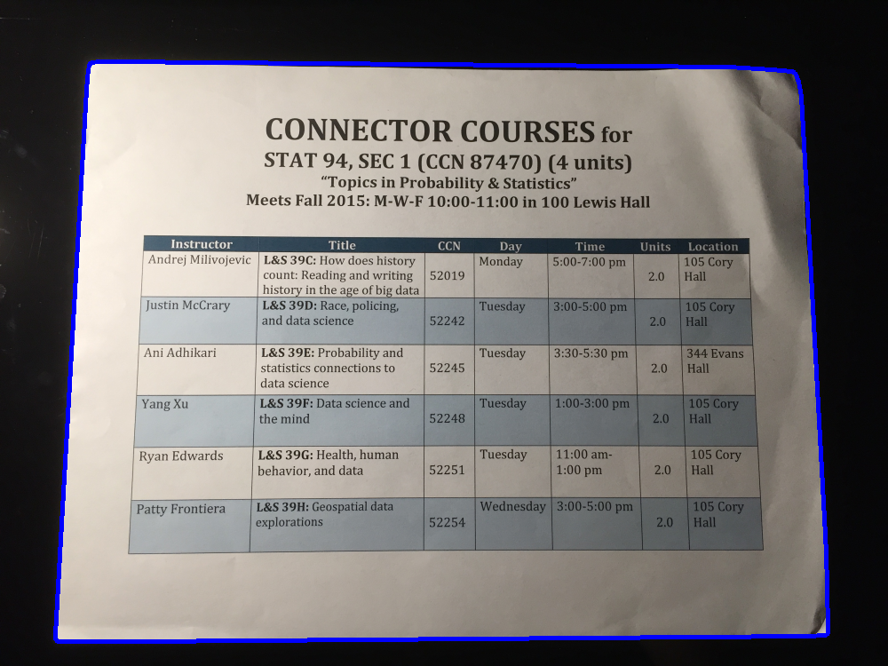

### 6.9 Polygon Approximation

복잡한 윤곽선을 단순한 다각형으로 근사하였다.

꼭짓점이 4개이며 볼록 다각형 조건을 만족하는 윤곽선을 문서 후보로 선택하였다.

- Function: cv2.approxPolyDP()
- Convexity Check: cv2.isContourConvex()
- Epsilon: 0.02 x Perimeter (Benchmark Configuration)

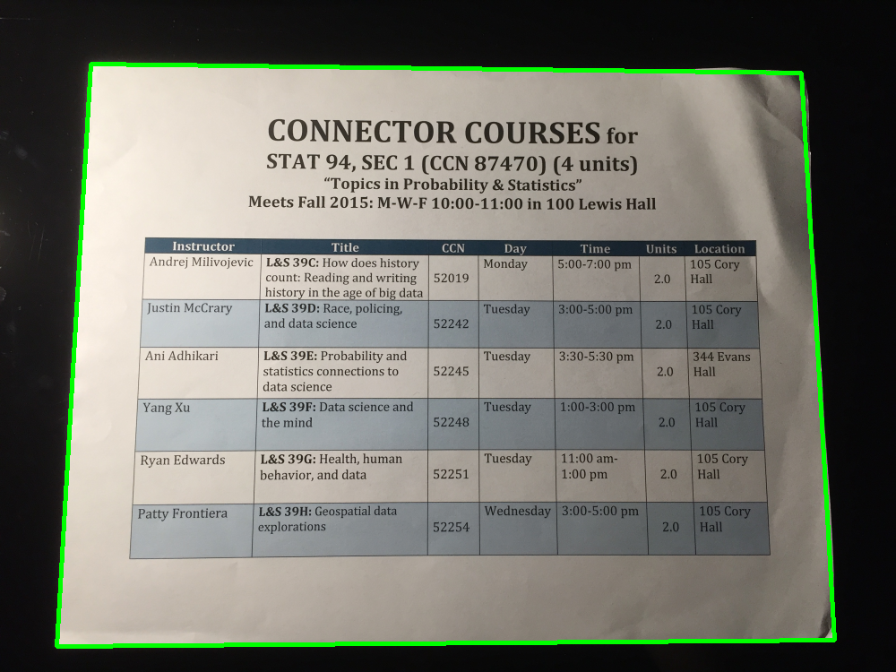

### 6.10 Corner Point Ordering

검출된 꼭짓점을 Perspective Transformation에 필요한 순서로 정렬하였다.

| Corner | Selection Criterion |
|---|---|
| Top-left | Minimum x + y |
| Top-right | Minimum y - x |
| Bottom-right | Maximum x + y |
| Bottom-left | Maximum y - x |

### 6.11 Perspective Transformation

원본 이미지의 꼭짓점 4개와 목적지 이미지의 꼭짓점 4개를 이용하여 3x3 Homography Matrix를 계산하였다.

출력 이미지 크기는 A4 용지의 가로세로 비율을 고려하여 600x849 pixels로 설정하였다.

- Function: cv2.getPerspectiveTransform()
- Function: cv2.warpPerspective()
- Output Resolution: 600x849

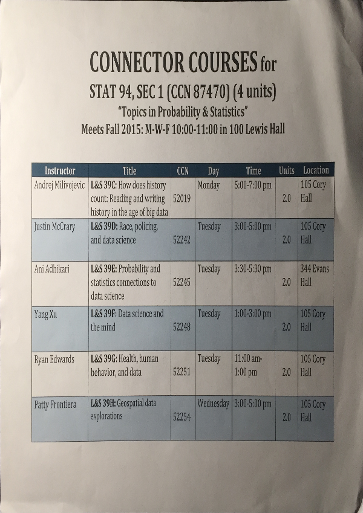

---

## 7. Algorithm Development and Optimization

### 7.1 Version 1 - Baseline Algorithm

기본적인 영상 전처리, 윤곽선 검출 및 다각형 근사를 사용하여 자동 문서 검출 알고리즘을 구현하였다.

#### Configuration

- Original Image Resolution
- Gaussian Blur: 13x13
- Canny Threshold: 30 / 150
- Closing Kernel: 7x7
- Top 5 Largest Contours
- Polygon Approximation

#### V1 Result

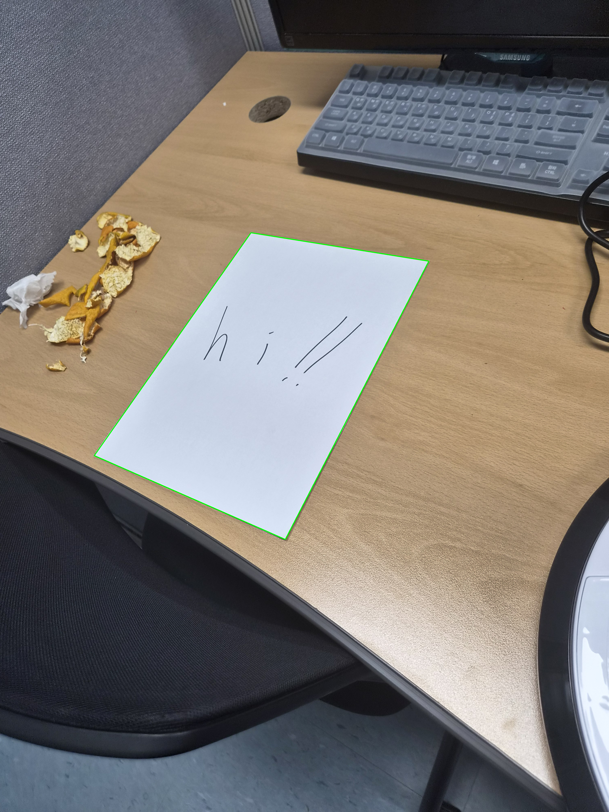

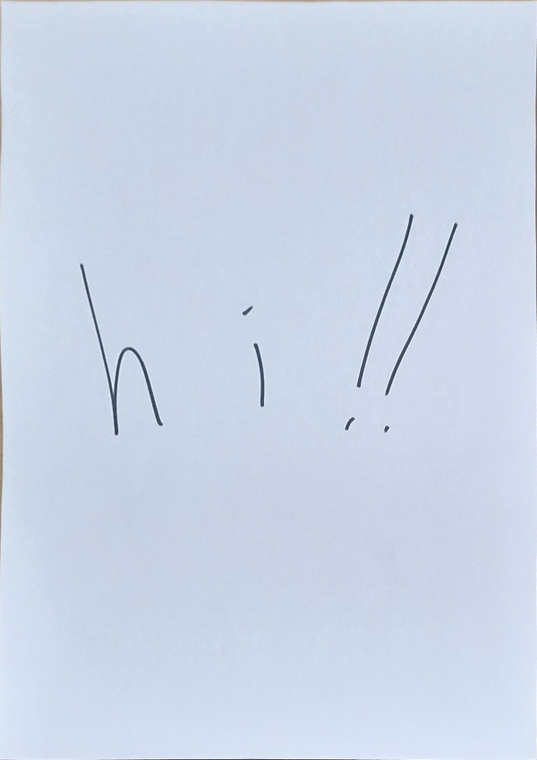

#### Problems

- 일부 문서 외곽선 미검출
- 문서 내부 영역 오검출
- 복잡한 윤곽선의 사각형 근사 실패
- 높은 입력 해상도로 인한 처리 시간 증가

#### Performance

| Metric | Result |
|---|---:|
| Successful Detection | 2/6 |
| Detection Success Rate | 33.3% |
| Average Detection Latency | 24.608 ms |

---

### 7.2 Version 2 - Contour Optimization

V1에서 발생한 오검출 및 미검출 문제를 분석하고 문서 후보 선택 조건을 개선하였다.

#### Improvements

- Gaussian Blur: 13x13 -> 9x9
- Canny High Threshold: 150 -> 100
- 최소 윤곽선 면적 조건 5% 추가
- 상위 5개 윤곽선에서 전체 윤곽선 탐색으로 변경
- Convex Hull 적용

다각형 근사 과정에서 꼭짓점이 4개로 근사되지 않는 문제를 확인하였다.

단순히 Polygon Approximation의 Epsilon 값을 증가시키는 방식만으로는 이러한 문제를 충분히 해결할 수 없었다.

따라서 Convex Hull을 적용하여 복잡한 윤곽선의 오목한 부분을 제거하고 사각형 근사 가능성을 개선하였다.

#### Remaining Problems

- Document 03: 문서 내부 표 영역 오검출
- Document 04: 문서 외곽선 미검출
- Document 06: 좌측 하단 꼭짓점 위치 오차
- 원본 해상도 기반 영상 처리로 인한 높은 연산량

#### False Detection

Document 03에서는 전체 문서가 아닌 문서 내부의 표 영역이 검출되었다.

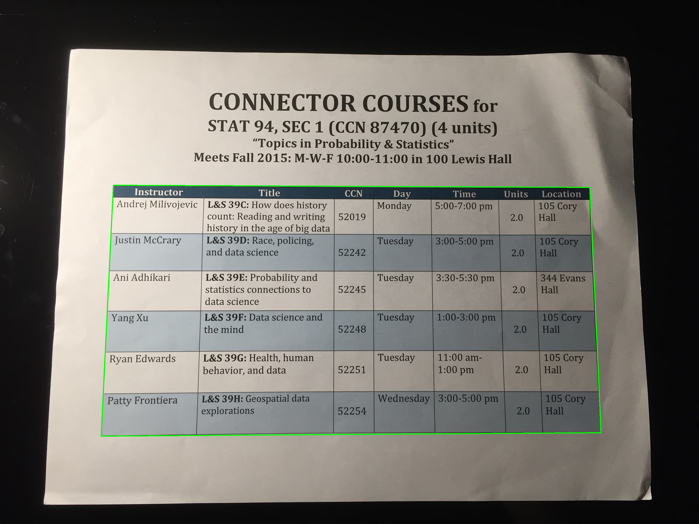

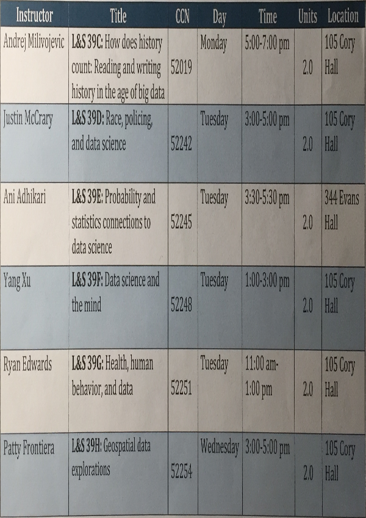

#### Partial Detection

Document 06에서는 문서 검출에는 성공하였으나 좌측 하단 꼭짓점에 위치 오차가 발생하였다.

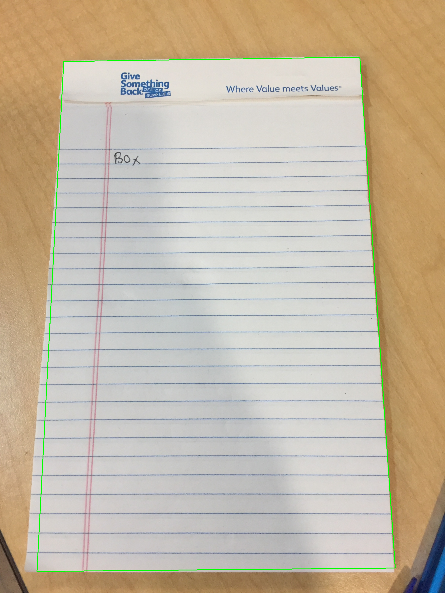

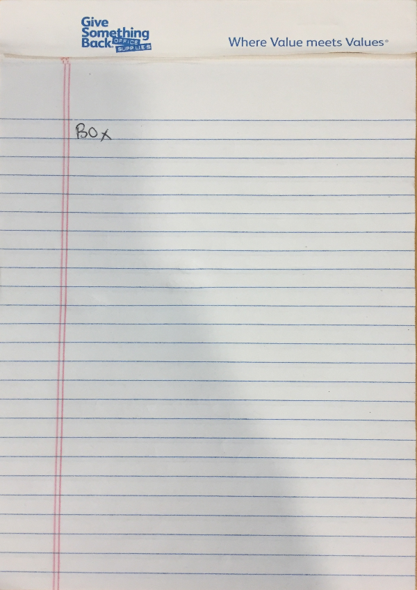

#### Performance

| Metric | Result |
|---|---:|
| Successful Detection | 3/6 |
| Partial Detection | 1/6 |
| Detection Success Rate | 50.0% |
| Average Detection Latency | 24.256 ms |

---

### 7.3 Version 3 - Resolution Normalization

V2에서 발생한 오검출 및 미검출 문제를 개선하기 위해 입력 이미지의 처리 해상도를 변경하였다.

동일한 Gaussian Blur 및 Morphological Closing 커널을 사용하더라도 이미지 해상도에 따라 필터의 상대적인 적용 범위가 달라질 수 있다.

따라서 입력 이미지의 긴 변을 최대 1000 pixels로 제한하였다.

```python
scale = min(1.0, 1000 / max(img.shape[:2]))

resized = cv2.resize(
    img,
    None,
    fx=scale,
    fy=scale,
    interpolation=cv2.INTER_AREA
)
```

이전 Interpolation 프로젝트에서 학습한 Downsampling 기법을 실제 문서 검출 문제에 적용하였다.

#### Original Coordinate Recovery

축소된 이미지에서 검출한 꼭짓점 좌표를 원본 이미지의 좌표계로 복원하였다.

```python
pts1[:, 0] *= img.shape[1] / resized.shape[1]
pts1[:, 1] *= img.shape[0] / resized.shape[0]
```

문서 검출은 축소된 이미지에서 수행하고, 최종 Perspective Transformation은 원본 이미지에서 수행하였다.

이를 통해 검출 단계의 연산량을 감소시키면서 축소된 이미지로부터 직접 원근 변환할 때 발생할 수 있는 추가적인 화질 손실을 방지하였다.

#### Improvements

- 문서 내부 표 영역 오검출 해결
- 문서 외곽선 미검출 해결
- 꼭짓점 위치 정확도 개선
- 미세한 배경 경계선의 영향 감소
- 영상 처리 연산량 감소
- 문서 검출 지연시간 감소

#### V2 vs V3 - Document 03

| V2 | V3 |
|---|---|
|  |  |
|  |  |

#### V2 vs V3 - Document 06

| V2 | V3 |
|---|---|
|  | 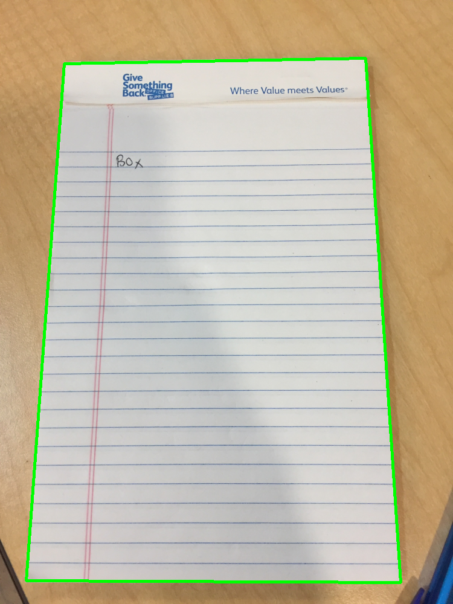 |
|  | 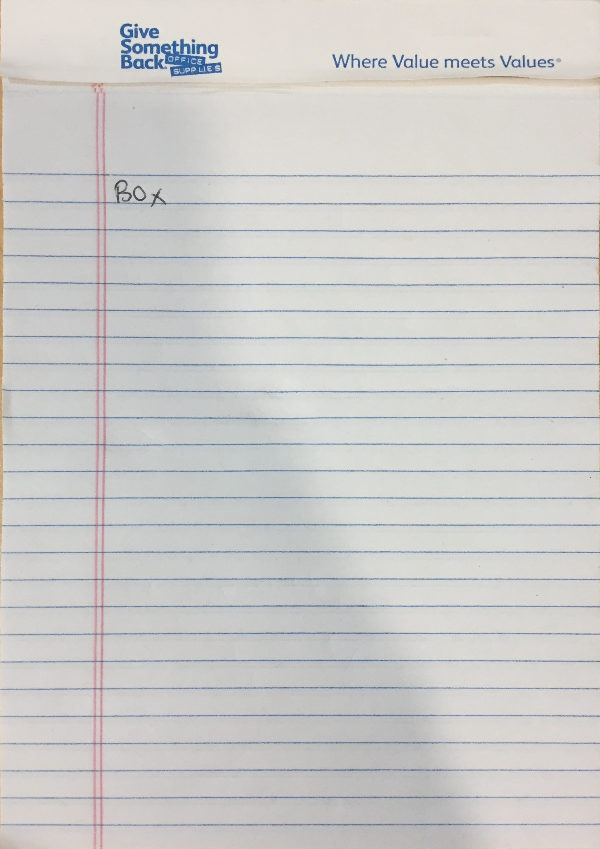 |

#### Performance

| Metric | Result |
|---|---:|
| Successful Detection | 6/6 |
| Detection Success Rate | 100% |
| Average Detection Latency | 6.145 ms |
| Average Total Latency | 7.329 ms |
| Detection Speedup | 4.00x |

입력 영상 처리 구조를 최적화하여 테스트 이미지에서 문서 검출 성능과 처리 속도를 동시에 개선하였다.

---

## 8. Algorithm Configuration Comparison

| Parameter | V1 | V2 | V3 |
|---|---|---|---|
| Input Resolution | Original | Original | Max 1000 px |
| Gaussian Blur | 13x13 | 9x9 | 9x9 |
| Canny Low Threshold | 30 | 30 | 30 |
| Canny High Threshold | 150 | 100 | 100 |
| Closing Kernel | 7x7 | 7x7 | 7x7 |
| Contour Candidates | Top 5 | All | All |
| Minimum Area Ratio | None | 5% | 5% |
| Convex Hull | X | O | O |
| Epsilon | 0.02 | 0.02 | 0.02 |
| Coordinate Recovery | X | X | O |
| Output Resolution | 600x849 | 600x849 | 600x849 |

위 설정은 성능 측정에 사용한 벤치마크 코드 기준이다.

---

## 9. Experimental Results (실험 결과)

총 6장의 테스트 이미지를 사용하여 알고리즘의 문서 검출 및 원근 보정 성능을 평가하였다.

### 9.1 Detection Result Comparison

| Test Image | V1 | V2 | V3 |
|---|---|---|---|
| Document 01 | Success | Success | Success |
| Document 02 | Fail | Success | Success |
| Document 03 | Fail | False Detection | Success |
| Document 04 | Fail | Not Detected | Success |
| Document 05 | Success | Success | Success |
| Document 06 | Fail | Partial Success | Success |
| **Success Rate** | **33.3%** | **50.0%** | **100%** |

정상적인 문서 영역 검출 및 프로젝트 범위 내 원근 보정을 수행한 경우 성공으로 분류하였다.

부분 검출과 잘못된 영역 검출은 성공률 계산에서 제외하였다.

### 9.2 Final Scanning Results (V3)

#### Document 01

| Original Image | Scanned Result |
|---|---|
| 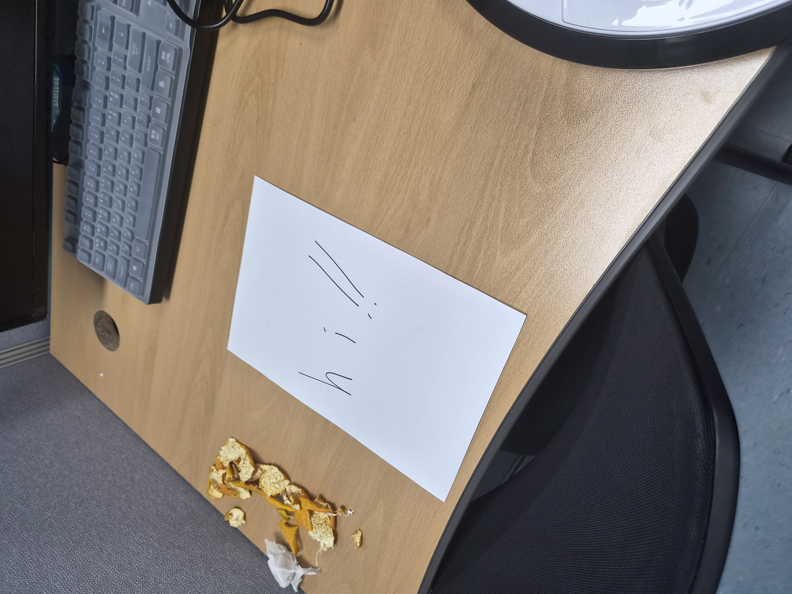 | 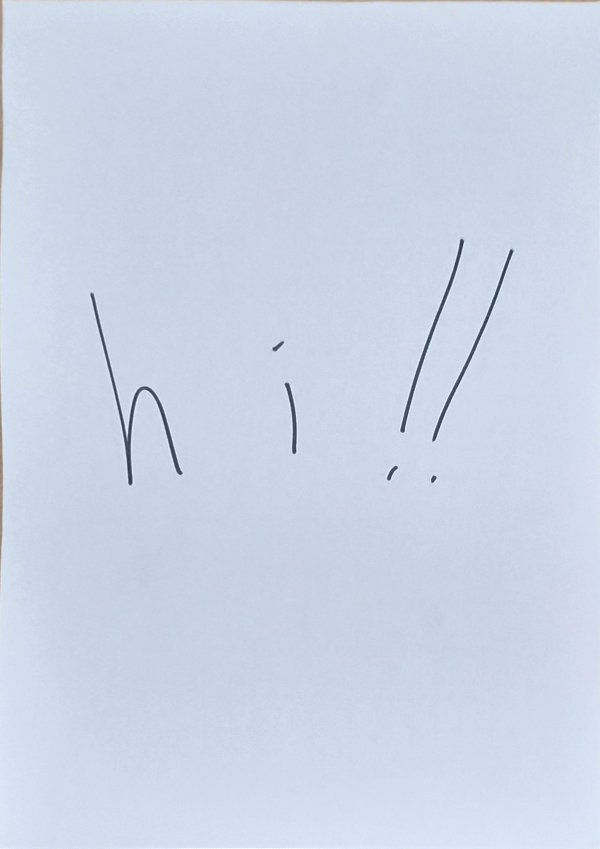 |

#### Document 02

| Original Image | Scanned Result |
|---|---|
| 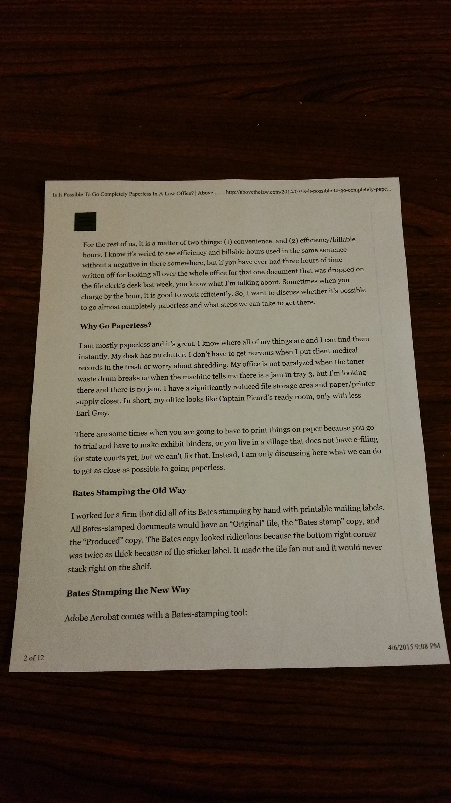 | 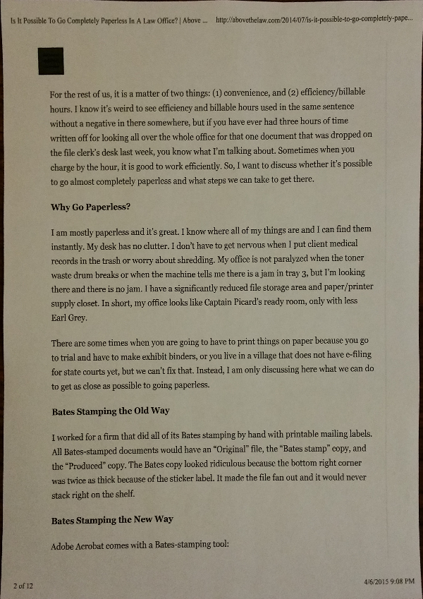 |

#### Document 03

| Original Image | Scanned Result |
|---|---|
|  |  |

#### Document 04

| Original Image | Scanned Result |
|---|---|
| 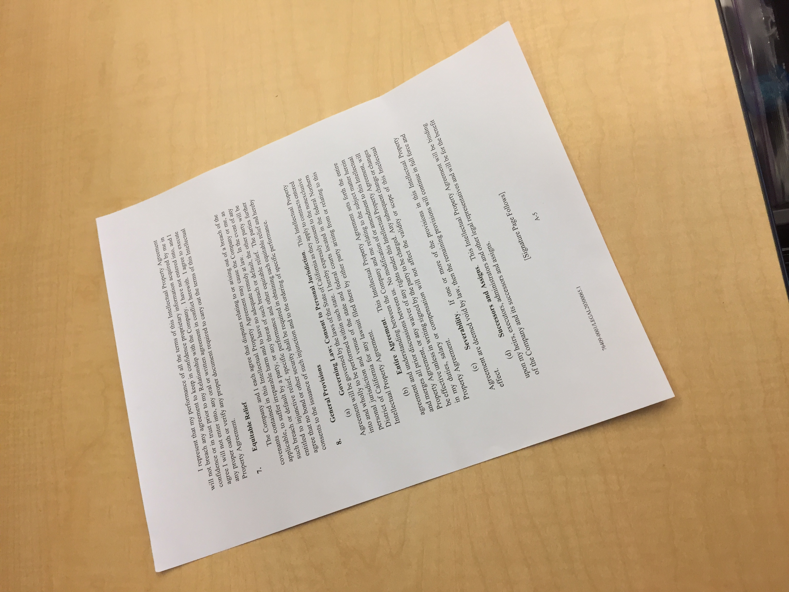 | 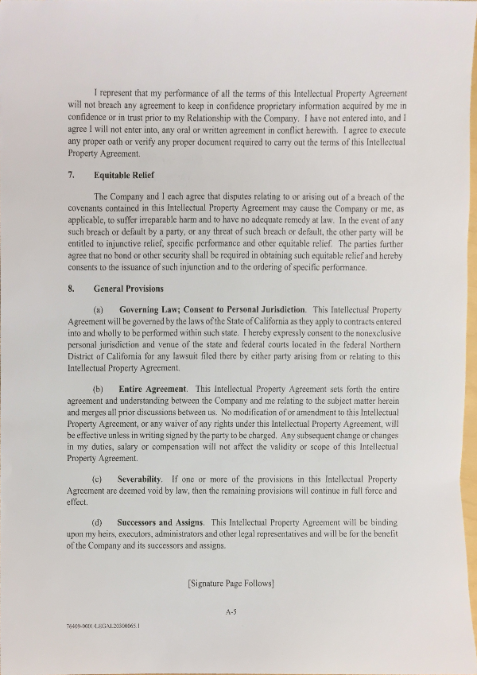 |

#### Document 05

| Original Image | Scanned Result |
|---|---|
| 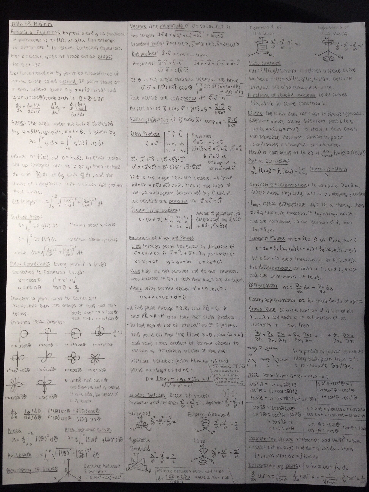 | 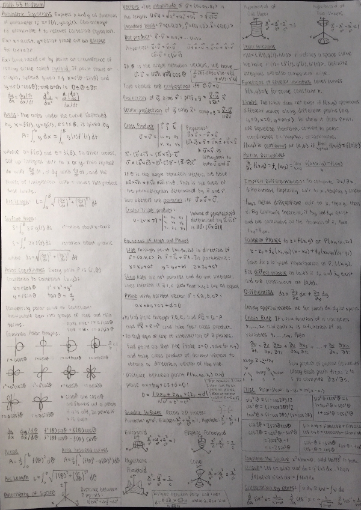 |

#### Document 06

| Original Image | Scanned Result |
|---|---|
| 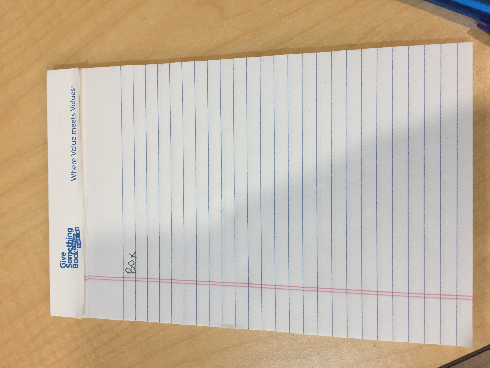 |  |

---

## 10. Performance Evaluation (성능 평가)

### 10.1 Benchmark Methodology

| Parameter | Configuration |
|---|---|
| Test Images | 6 |
| Algorithm Versions | V1, V2, V3 |
| Warm-up | 10 iterations |
| Repeated Measurements | 100 iterations |
| Timing Function | time.perf_counter() |
| Measurement Unit | Milliseconds (ms) |
| Output Resolution | 600x849 |
| Image Loading | Excluded |
| Image Saving | Excluded |
| Visualization | Excluded |

### Measurement Metrics

- Detection Latency: 영상 전처리부터 문서 꼭짓점 검출, 좌표 정렬 및 좌표 복원까지의 처리 시간
- Warp Latency: 변환 행렬 계산 및 원근 변환 시간
- Total Latency: 검출 및 원근 변환 전체 처리 시간
- Detection STD: 반복 측정에 대한 검출 시간의 표준편차
- Detection Speedup: V1 대비 평균 검출 속도 향상 배율

Raw benchmark data:

[Latency Results CSV](benchmark_results/latency_results.csv)

---

### 10.2 Detection Success Rate

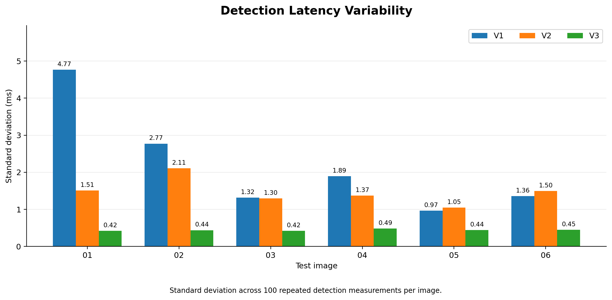

| Version | Successful Detection | Success Rate |
|---|---:|---:|
| V1 | 2/6 | 33.3% |
| V2 | 3/6 | 50.0% |
| V3 | 6/6 | 100% |

V1 대비 V3의 검출 성공률은 66.7 percentage points 향상되었다.

---

### 10.3 Detection Latency

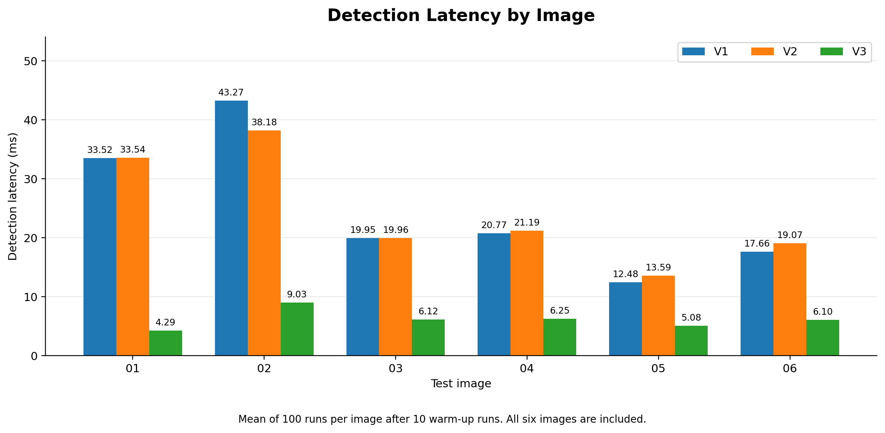

| Image | V1 (ms) | V2 (ms) | V3 (ms) |
|---|---:|---:|---:|
| Document 01 | 33.520 | 33.544 | 4.295 |
| Document 02 | 43.268 | 38.180 | 9.034 |
| Document 03 | 19.946 | 19.958 | 6.120 |
| Document 04 | 20.772 | 21.186 | 6.250 |
| Document 05 | 12.478 | 13.594 | 5.076 |
| Document 06 | 17.663 | 19.073 | 6.096 |
| **Average** | **24.608** | **24.256** | **6.145** |

### Average Detection Latency


V2에서는 최소 면적 필터링 및 Convex Hull을 적용하여
문서 검출 성공률을 개선하였으나 평균 검출 시간에는
큰 변화가 없었다.

반면 V3에서는 입력 이미지의 긴 변을 최대 1000 pixels로
제한하여 영상 처리 연산량을 감소시켰다.

V3는 모든 테스트 이미지에서 V1 및 V2보다 낮은
검출 지연시간을 기록하였다.

- V1 대비 V3 검출 지연시간 감소율: 75.03%
- V2 대비 V3 검출 지연시간 감소율: 74.67%
- V1 대비 V3 검출 속도 향상: 4.00x

---

### 10.4 Detection Speedup


| Version | Average Detection Latency | Speedup |
|---|---:|---:|
| V1 | 24.608 ms | 1.00x |
| V2 | 24.256 ms | 1.01x |
| V3 | 6.145 ms | 4.00x |

V1을 기준으로 평균 검출 지연시간의 비율을 계산하였다.

최종 V3 알고리즘에서 약 4배의 검출 속도 향상을 확인하였다.

---

### 10.5 Perspective Transform Latency

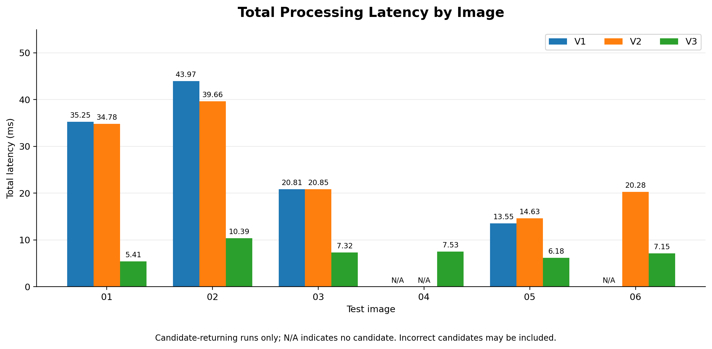

모든 알고리즘 버전은 동일한 출력 해상도인 600x849 pixels를 사용하였다.

입력 해상도 축소에 따른 주요 성능 향상은 Perspective Transformation 단계보다 영상 전처리 및 문서 검출 단계에서 발생하였다.

문서 후보가 반환되지 않은 경우 Perspective Transformation을 수행하지 않았으므로 N/A로 표시하였다.

---

### 10.6 Total Processing Latency

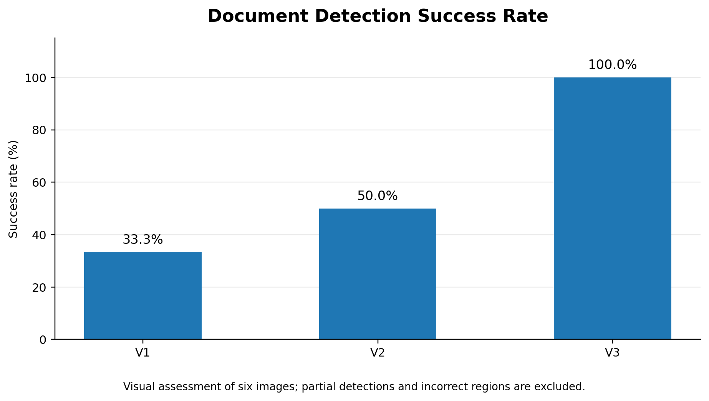

공정한 비교를 위해 세 버전에서 모두 정상적으로 검출한 Document 01과 Document 05를 기준으로 전체 처리 시간을 비교하였다.

| Version | Average Total Latency |
|---|---:|
| V1 | 24.398 ms |
| V2 | 24.706 ms |
| V3 | 5.794 ms |

공통 성공 이미지 기준으로 V3는 V1 대비 약 4.21배의 전체 처리 속도 향상을 기록하였다.

---

### 10.7 Total Latency by Image

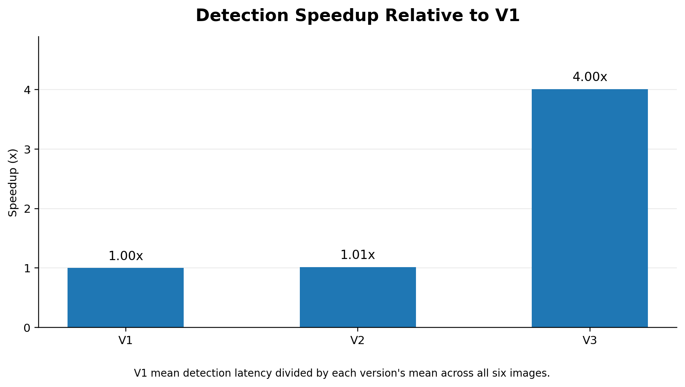

최종 V3의 전체 테스트 이미지에 대한 평균 처리 시간은 7.329 ms이다.

| Image | V3 Total Latency |
|---|---:|
| Document 01 | 5.407 ms |
| Document 02 | 10.389 ms |
| Document 03 | 7.321 ms |
| Document 04 | 7.527 ms |
| Document 05 | 6.180 ms |
| Document 06 | 7.153 ms |
| **Average** | **7.329 ms** |

단, 사각형 후보를 반환한 경우 실제 문서가 아닌 영역을 검출하였더라도 변환 시간이 측정될 수 있다.

따라서 사각형 후보 반환 여부와 실제 검출 성공 여부를 구분하여 평가하였다.

---

### 10.8 Detection Latency Standard Deviation

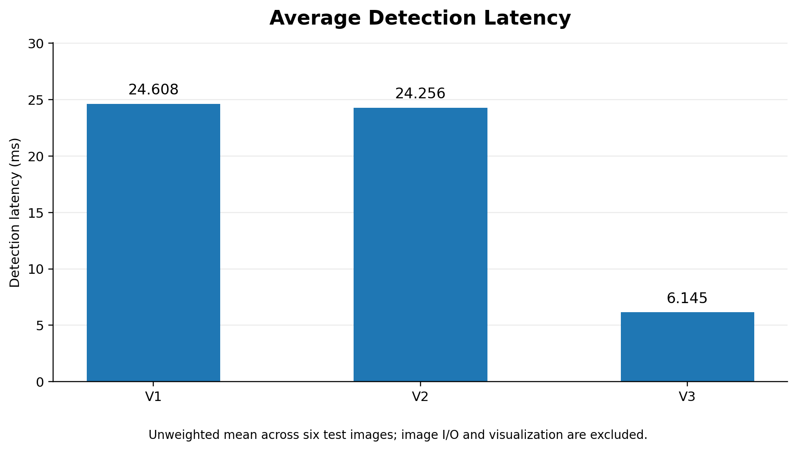

이미지별 100회 반복 측정을 통해 검출 지연시간의 표준편차를 비교하였다.

V3에서는 모든 테스트 이미지의 표준편차가 0.5 ms 미만으로 측정되었다.

이는 해당 실험 환경에서 최종 알고리즘의 검출 처리 시간이 이전 버전보다 일관적이었음을 보여준다.

---

## 11. Discussion (결과 분석)

### V1 to V2

문서 검출에 실패한 이미지의 윤곽선 형태와 다각형 근사 결과를 분석하였다.

최소 면적 필터링, 전체 윤곽선 탐색 및 Convex Hull을 적용하여 문서 검출 성공률을 33.3%에서 50.0%로 향상시켰다.

그러나 원본 해상도에서 영상 처리를 수행하였기 때문에 평균 검출 지연시간에는 큰 변화가 없었다.

### V2 to V3

입력 이미지의 긴 변을 최대 1000 pixels로 제한하여 영상 처리 해상도를 최적화하였다.

입력 해상도 축소는 다음과 같은 개선에 기여한 것으로 판단된다.

- 불필요한 세부 경계선 감소
- 고정 크기 필터의 상대적인 적용 범위 증가
- 윤곽선 검출 구조 개선
- 처리 픽셀 수 감소

그 결과 기존 오검출 및 미검출 사례를 해결하였으며, 모든 테스트 이미지에서 검출 지연시간을 감소시켰다.

다만 각각의 요인이 성능 개선에 기여한 정도는 별도의 Ablation Study를 수행하지 않았으므로 정량적으로 구분하지 않았다.

---

## 12. Limitations (한계점)

### Non-planar Document Distortion

Document 04에서는 종이 자체가 휘어져 있는 것을 확인하였다.


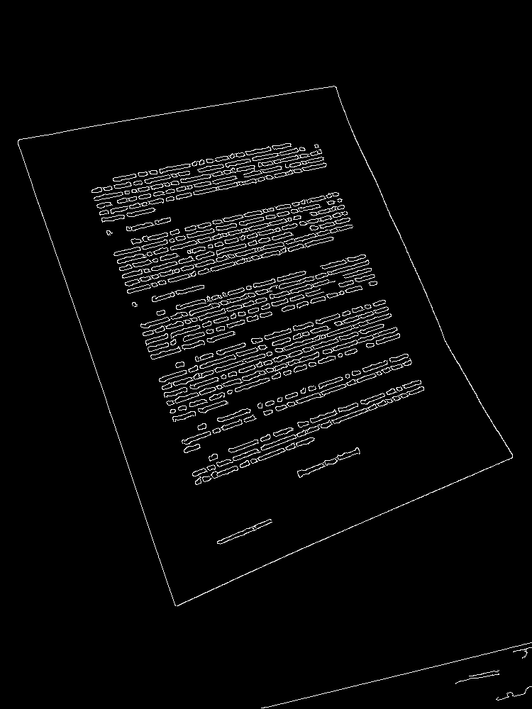


문서의 외곽선은 검출되었으나, 종이 자체의 휘어짐으로 인해 최종 원근 보정 결과에 일부 곡면 왜곡과 배경 영역이 남아 있었다.

Perspective Transformation은 평면 물체를 가정하는 기하학적 변환이므로 비평면 문서의 곡면 왜곡을 완전히 보정할 수 없다.

이러한 문제는 Document Dewarping이라는 별도의 비선형 영상 보정 기술이 필요하다.

따라서 본 프로젝트에서는 해당 이미지의 문서 검출 및 원근 보정을 성공으로 분류하였다.

### Other Limitations

- 테스트 이미지가 6장으로 제한됨.
- 알고리즘 개선과 평가에 동일한 이미지 사용.
- 검출 성공 여부를 육안으로 평가함.
- Ground Truth 기반 IoU 및 Corner Error 미측정.
- 출력 해상도가 600x849 pixels로 고정됨.
- 문서가 없는 이미지에 대한 오검출률 미평가.
- 극단적인 회전 환경에서 꼭짓점 정렬 오류 발생 가능.
- 고정된 영상 처리 파라미터로 인해 조명 및 배경 변화에 민감할 수 있음.

---

## 13. Robotics and Computer Vision Applications

본 프로젝트에서 구현한 문서 검출 및 원근 변환 알고리즘은 다양한 로봇 비전 및 산업용 영상 처리 시스템에 응용할 수 있다.

| Application | Description |
|---|---|
| Robot Workspace Rectification | 로봇 작업 영역의 원근 왜곡 보정 |
| Industrial Inspection | 평면 제품의 검사 이미지 보정 |
| OCR Preprocessing | 문자 인식 전 문서 및 라벨 보정 |
| Conveyor Belt Vision | 컨베이어 위 평면 물체 검출 |
| Planar Object Detection | 평면 물체 외곽선 및 꼭짓점 검출 |
| Embedded Vision | 영상 처리 해상도 최적화 및 연산량 감소 |

---

## 14. Future Work (향후 개선 방향)

- 독립적인 문서 데이터셋을 활용한 성능 평가
- Ground Truth 기반 검출 정확도 측정
- Adaptive Canny Threshold 적용
- 문서 꼭짓점 정밀 검출
- 출력 해상도 자동 설정
- Document Dewarping
- 문서 조명 및 그림자 보정
- 실시간 카메라 기반 문서 스캔
- OCR 및 PDF 저장 기능 연동
- 임베디드 시스템 기반 성능 평가

---

## 15. Project Structure

```text
Perspective_Transformation/
├── benchmark_results/
│   └── latency_results.csv
│
├── images/
│   ├── document_01.jpg
│   ├── document_02.jpg
│   ├── document_03.jpg
│   ├── document_04.jpg
│   ├── document_05.jpg
│   └── document_06.jpg
│
├── results/
│   ├── Average_Detection_Latency.png
│   ├── Detection_Latency.png
│   ├── Detection_Latency_STD.png
│   ├── Detection_Speedup.png
│   ├── Detection_Success_Rate.png
│   ├── Total_Latency_by_Image.png
│   ├── Total_Processing_Latency.png
│   └── Warp_Latency.png
│
├── v1_results_01/
│
├── v2_results_01/
├── v2_results_02/
├── v2_results_03/
├── v2_results_04/
├── v2_results_05/
├── v2_results_06/
│
├── v3_results_01/
├── v3_results_02/
├── v3_results_03/
├── v3_results_04/
├── v3_results_05/
├── v3_results_06/
│
├── automatic_perspective_v1.py
├── automatic_perspective_v2.py
├── automatic_perspective_v3.py
├── manual_perspective.py
├── benchmark.py
└── README.md
```

---

## 16. How to Run

### Install Dependencies

```bash
pip install opencv-python numpy matplotlib
```

### Manual Perspective Transformation

```bash
python manual_perspective.py
```

### Automatic Document Scanner V1

```bash
python automatic_perspective_v1.py
```

### Automatic Document Scanner V2

```bash
python automatic_perspective_v2.py
```

### Automatic Document Scanner V3

```bash
python automatic_perspective_v3.py
```

### Performance Benchmark

```bash
python "benchmark.py"
```

테스트 이미지 경로는 각 Python 파일 내부에서 변경할 수 있다.

---

## 17. Image Sources

- Document 01: Self-captured image
- External Sample Images: [OpenCV Document Scanner - Sample Images](https://github.com/andrewdcampbell/OpenCV-Document-Scanner/tree/master/sample_images)

외부 샘플 이미지는 문서 검출 및 원근 보정 알고리즘의 성능 평가 목적으로 사용하였다.

외부 이미지의 권리 및 라이선스는 원본 출처를 따른다.

---

## 18. Conclusion (결론)

본 프로젝트에서는 Python과 OpenCV를 활용하여 수동 원근 변환부터 자동 문서 검출 및 원근 보정 알고리즘까지 단계적으로 구현하였다.

초기 알고리즘에서 발생한 오검출 및 미검출 문제를 분석하고, 영상 처리 파라미터 변경, 최소 면적 필터링, Convex Hull 및 입력 해상도 최적화를 적용하였다.

최종 V3 알고리즘은 다음과 같은 성능 개선 결과를 달성하였다.

- Detection Success Rate: 33.3% -> 100%
- Average Detection Latency: 24.608 ms -> 6.145 ms
- Detection Latency Reduction: 75.03%
- Detection Speedup: 4.00x
- Total Processing Speedup: 4.21x (Common Successful Images)
- Average Total Processing Latency: 7.329 ms

본 실험을 통해 영상 처리 알고리즘의 구조와 입력 해상도를 최적화하는 방식으로 검출 성능과 처리 효율을 동시에 향상시킬 수 있음을 확인하였다.

향후 이러한 영상 처리 및 최적화 경험을 기반으로 로봇 비전, 산업용 머신 비전 및 임베디드 영상 처리 시스템으로 확장하고자 한다.