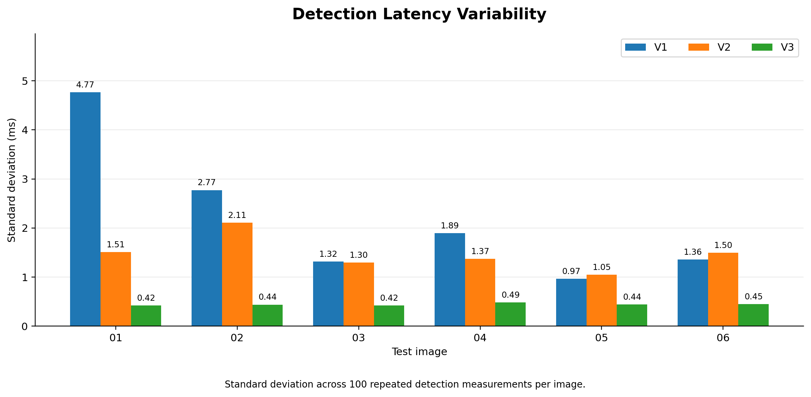
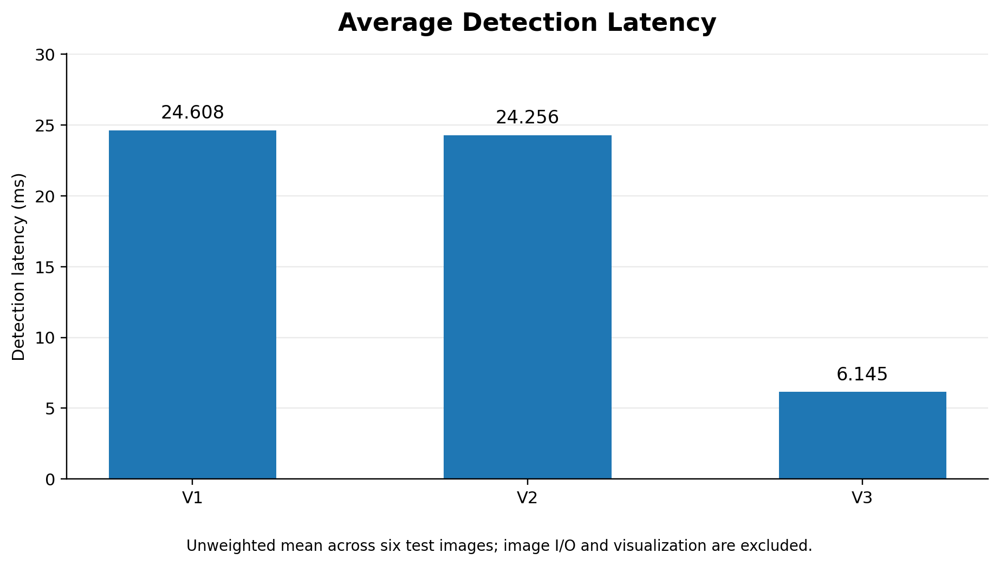

# Computer-Vision-Study

Computer vision experiments, algorithm development, and performance optimization using Python and OpenCV.

## Overview

This repository contains computer vision projects focused on image processing, geometric transformation, algorithm optimization, and performance evaluation.

## Projects

### 01. Geometric Transformation

#### 1. Interpolation

Comparison and performance analysis of image interpolation algorithms.

- Nearest Neighbor Interpolation
- Bilinear Interpolation
- Bicubic Interpolation
- Area Interpolation
- Processing Latency Analysis
- PSNR and SSIM Evaluation

[View Project](01_Geometric_Transformation/Interpolation/)

#### 2. Automatic Document Scanner

Automatic document detection and perspective correction using OpenCV.

- Manual and Automatic Perspective Transformation
- Canny Edge Detection
- Morphological Closing
- Contour Optimization
- Convex Hull
- Input Resolution Normalization

**Performance Results**

| Metric | V1 | V3 |
|---|---:|---:|
| Detection Success Rate | 33.3% | 100% |
| Average Detection Latency | 24.608 ms | 6.145 ms |
| Detection Speedup | 1.00x | 4.00x |

Detection success was evaluated using six test images.

[View Project](01_Geometric_Transformation/Perspective_Transformation/)

## Development Environment

- Python
- OpenCV
- NumPy
- Matplotlib
- Visual Studio Code
- Git / GitHub

## Study Objectives

- Understanding computer vision algorithms
- Implementing practical image processing systems
- Analyzing algorithm performance
- Improving accuracy and computational efficiency
- Applying computer vision to robotics and embedded systems